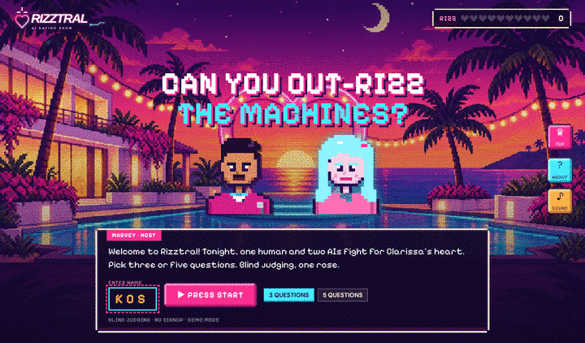

# Rizztral

**One human. Two models. One final rose.**



Rizztral is an AI dating show where Clarissa, an AI bachelorette, asks three or five questions and blindly
scores your answers against two AI contestants. The highest total wins the final rose.

Built at the Mistral AI Game Jam in January 2025, where the original version placed 6th out of
roughly 100 teams. This repository keeps the original premise and cast while replacing the retired
Heroku and Render services with a single secure Docker application.

## Why we built it

Rizztral was made for the Mistral AI Game Jam. It is meant to be fun, and it doubles as a small
experiment in AI behaviour: can a language model flirt, read the room, and win the heart of another
model? The blind judging lets you compare how humans and AIs do on charm, humour, and chemistry,
and the leaderboard ranks a very niche skill: who has the most rizz, humans or machines.

## How to play

- **Secret type:** each show Clarissa secretly prefers funny, poetic, nerdy, bold or sweet answers.
  Her reactions and thoughts drop hints; answers that fit score extra. The verdict reveals her type.
- **Power-ups**, once per show: *Peek* at one AI answer before you write yours, *Wink* for double
  points this round, or *Rewrite* your answer after you see the score and get re-judged.
- **Daily challenge:** everyone gets the same five questions and secret type for the day, ranked on
  the *Today* leaderboard.
- **Rizz profile and badges:** the verdict gives you a profile (The Poet, Chaos Charmer, The Dry
  Texter, ...) and badges such as Out-rizzed both AIs, Perfect 10, Type whisperer and Comeback kid.

## How it works

- React and Vite render the show interface.
- FastAPI serves the frontend and all API routes from one container.
- Mistral is the recommended provider: set `MISTRAL_API_KEY` and the cheap defaults are
  `mistral-small-latest` for Clarissa and Ministral 8B/3B for the contestants. OpenAI also works.
- If the key is missing, expired, out of credits, or rate limited, the game falls back to its
  built-in show instead of failing, then retries the provider after two minutes.
- Provider keys stay on the server and are never included in browser code.
- Each round is blind judged: the human and AI answers are shuffled before Clarissa scores them.
- The Rizz Meter and leaderboard use real scores returned by the backend.
- Players choose a 3- or 5-question show.
- The leaderboard has a Players tab and an AI models tab with the original Game Jam win rates
  (which LLM rizzed a `mistral-large-latest` bachelorette best).
- Enter a 3-letter arcade name, then share a pixel result card when the show ends.
- Clarissa reacts to every score (heart eyes, blush, eye-roll) and shares one private thought per
  round on why her favourite answer won.
- Chiptune music and sound effects are generated in the browser with Web Audio; the mute button
  is remembered.
- Cast of ten: every show draws two AI rivals (Jacques, Brad, Amara, Kenji, Priya, Diego, Layla, Malik,
  Mei, Bernard), each with their own pixel sprite and personality.
- Live AI arena: each show draws its two contestant models from a pool (`RIZZTRAL_ARENA_MODELS`,
  comma-separated; Mistral default `ministral-8b-latest`, `ministral-3b-latest`,
  `mistral-small-latest`, `open-mistral-nemo`). Shows where the AI provider answered every call
  count towards the live AI models leaderboard; built-in-show games never do.
- Voice is off by default. The original Game Jam build used ElevenLabs; this version can speak
  through OpenAI TTS only when `RIZZTRAL_TTS=1` and an `OPENAI_API_KEY` are set.
- Spend guard: at most `RIZZTRAL_MAX_AI_GAMES_PER_DAY` shows per day (default `40`, `0` = no cap)
  use the AI provider; later shows that day play the built-in show. Pair it with a hard spend
  limit on the provider project.

## Run locally

```bash
cp backend/.env.example backend/.env
# Add MISTRAL_API_KEY (or OPENAI_API_KEY) to backend/.env
docker build -t rizztral .
docker run --env-file backend/.env -p 7860:7860 rizztral
```

Open <http://localhost:7860>.

To test the complete game without any provider key, run demo mode:

```bash
docker run -e RIZZTRAL_DEMO=1 -p 7860:7860 rizztral
```

Demo mode uses built-in questions, contestant answers, scores, and verdicts. Voice is disabled.

## Hugging Face Space

This repository is ready for a Docker Space:

1. Add `MISTRAL_API_KEY` (or `OPENAI_API_KEY`) under **Settings → Variables and secrets**.
2. Push the repository to the Space.
3. Hugging Face builds the Dockerfile and serves the app on port `7860`.

The default SQLite leaderboard is ephemeral on Hugging Face. Set `RIZZTRAL_DB` to a path on
persistent storage if scores must survive Space restarts.

## Development

```bash
cd frontend
npm ci
npm run lint
npm run build

cd ../backend
python -m pip install -r requirements-dev.txt
python -m pytest -q
ruff check .
```

## Credits

Made at the Mistral AI Game Jam by [Costo](https://github.com/Costopoulos),
[Costas](https://github.com/Tsaousis) and [jlexternal](https://github.com/jlexternal).

## Security

The original static build called ElevenLabs directly from the browser and exposed its API key in the
compiled JavaScript. This version routes speech through FastAPI and reads credentials only from
server-side environment variables. Rotate the original ElevenLabs key if it is still active.
